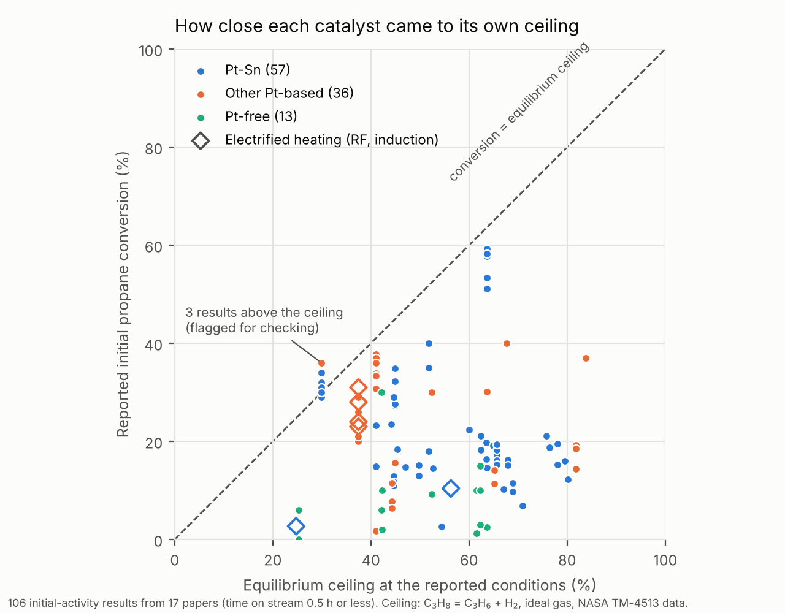

# OpenPDH-Bench

**Status:** v1.0.0, released 19 October 2026 | **Maintainer:** Somtochukwu Lambert, Independent Researcher, College Station, Texas ([ORCID 0009-0008-1386-6141](https://orcid.org/0009-0008-1386-6141)) | **License:** data and docs CC BY 4.0, code MIT

**In plain terms:** Propylene is a building block for plastics and chemicals, and turning propane into propylene ("propane dehydrogenation") is a large industry. Hundreds of papers report new catalysts for it, but every lab tests at different temperatures, pressures and dilutions, so their results can't be compared directly. OpenPDH-Bench collects published results into one open table and places each result against the highest conversion thermodynamics allows at that result's own conditions. It also records how the reactor was heated, including electrified methods such as induction and radio-frequency heating.

Unfamiliar terms are explained in [docs/GLOSSARY.md](docs/GLOSSARY.md).

OpenPDH-Bench is a harmonized, versioned dataset of non-oxidative propane dehydrogenation (PDH) catalyst performance extracted from the peer-reviewed literature under a written protocol, with a reproducible equilibrium layer computed from public-domain NASA thermodynamic data. Each row is one reported test point with full conditions and a DOI-level citation. Computed columns give the single-reaction equilibrium conversion, approach to equilibrium, an above-ceiling flag, a standardized deactivation constant and a computed space velocity.

## Headline numbers (from `paper/stats.json`)

<!-- headline:start -->
Equilibrium calculator: 18 of 18 checks pass (`data/processed/qa_equilibrium.txt`). Reaction enthalpy at 25 °C: 124.4 kJ/mol. For pure propane at 1 bar the ceiling is 31.0% at 550 °C, 48.9% at 600 °C and 67.4% at 650 °C; diluting to 10% propane raises the 600 °C ceiling to 80.8%.

Catalyst data: 153 test points for 51 catalysts from 17 papers (17 of 17 checked against the paper by the curator). 3 points sit above the equilibrium ceiling and are flagged.
<!-- headline:end -->



## What is here

```
code/
  00_literature.py             finds open-access papers (Europe PMC), downloads text for reading
  pdh_equilibrium.py           equilibrium ceiling calculator (standard library only)
  schema.py                    the single definition of every column
  01_fetch_thermo.py           extracts NASA coefficients, logs provenance
  02_equilibrium_reference.py  reference grid + checks against independent values
  03_build_and_qa.py           validates extracted data, adds computed columns, writes release table
  04_figures.py                figures
  05_document.py               writes the README headline numbers from stats.json
data/raw/                      NASA coefficients + PROVENANCE.txt
data/extraction/               sources, catalysts, measurements, quoted equilibria; search and screening logs
data/processed/                release table, equilibrium reference, QA reports
docs/                          CODEBOOK, EXTRACTION_PROTOCOL (with decision record), LIMITATIONS, NEXT_STEPS, GLOSSARY
paper/                         stats.json and figures
tests/                         self-test on an invented fixture (never part of the data)
tools/                         provenance logger, publish gate, DOI check (Crossref), number trace check
```

**The file most people want:** `data/processed/openpdh_measurements.csv`, one row per reported test point, columns explained in [docs/CODEBOOK.md](docs/CODEBOOK.md).

## Run it

```
pip install -r requirements.txt
python code/01_fetch_thermo.py
python code/02_equilibrium_reference.py
python code/03_build_and_qa.py
python code/04_figures.py --final
python code/05_document.py
python tests/run_tests.py
python tools/check_dois.py        # needs internet
python tools/trace_check.py       # needs the papers: python code/00_literature.py fetch <PMCIDs in sources.csv>
```

Every script prints its result and exits non-zero on a failed check.

## Use the equilibrium calculator on its own

```python
import sys; sys.path.insert(0, "code")
from pdh_equilibrium import eq_conversion
eq_conversion(600, P_bar=1.0, y_C3H8=0.1)            # 10% propane in N2 at 600 C -> ~0.81
eq_conversion(600, P_bar=1.0, y_C3H8=0.5, y_H2=0.5)  # 1:1 H2 co-feed -> ~0.35
```

## Sources

| Source | Vintage | License | Accessed |
|---|---|---|---|
| NASA TM-4513, McBride, Gordon & Reno, https://ntrs.nasa.gov/citations/19940013151, via Cantera 3.2.0 `nasa_gas.yaml` | 1993 | Public domain (US Government work) | 2026-10-19 |
| NIST Chemistry WebBook, https://webbook.nist.gov (check values only) | 2026 web edition | Public, US Government | 2026-10-19 |
| Peer-reviewed PDH papers, one DOI per row in `data/extraction/sources.csv` | 2017 to 2026 | Facts only; no text or images reproduced | 2026-10-19 |
| Europe PMC REST API (finding and reading open-access papers), https://europepmc.org | live | Full texts under each article's own license; not redistributed | 2026-10-19 |
| Crossref REST API (citation check), https://api.crossref.org | live | Metadata, CC0 | 2026-10-19 |

## How the data were made

Papers were found through Europe PMC and screened under the written protocol in [docs/EXTRACTION_PROTOCOL.md](docs/EXTRACTION_PROTOCOL.md); every paper looked at is listed in `data/extraction/screening_log.csv` with the reason it was included, deferred or excluded. Values were entered with software assistance and checked against each paper by the curator. Every build re-runs automatic checks: each number is traced to its paper's text, each citation is matched to Crossref, and each result is tested against the physics (nothing should beat the equilibrium ceiling by more than 2 points without a flag). The maintainer is a co-author of one included paper (S0017).

## Limitations

See [docs/LIMITATIONS.md](docs/LIMITATIONS.md) before using or citing anything here. In short: the ceiling is for the dehydrogenation reaction alone, it is only as good as each paper's reported temperature, and version 1.0 includes only values printed as numbers (not read from figures).

## Contributing and corrections

Found a wrong value, or want your own results included? Open an issue with the row ID and the paper location. Corrections are released as new versions; old versions stay citable.

## Citation

See `CITATION.cff`. A DOI is minted when this release is archived on Zenodo.
